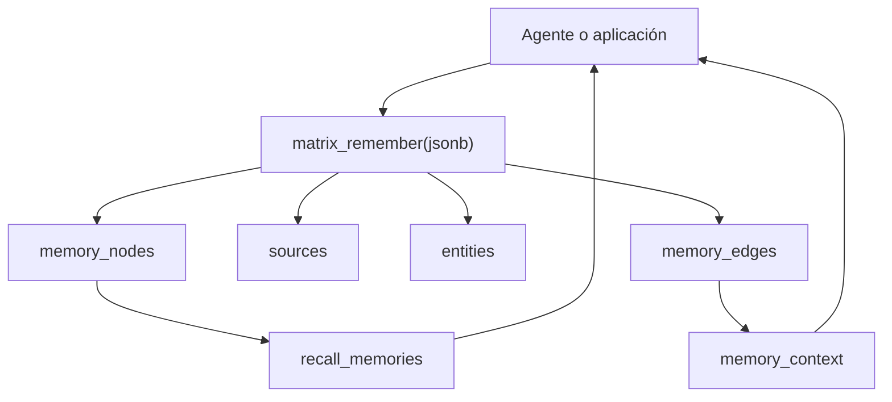

# Matrix Memory

Modelo educativo de memoria semántica de largo plazo para agentes de IA, construido sobre PostgreSQL y Supabase.

Matrix representa los recuerdos como nodos atómicos conectados con entidades, fuentes y relaciones tipadas. Combina búsqueda de texto completo, vectores, importancia, confianza y contexto asociativo.

> Este repositorio contiene solamente arquitectura, migraciones y datos sintéticos. No incluye recuerdos personales, identificadores reales ni credenciales.

## Capacidades

- Memorias atómicas con procedencia y contexto temporal.
- Clave idempotente `event_key` para evitar duplicados.
- Historial de versiones al modificar una memoria.
- Entidades reutilizables: personas, organizaciones, proyectos y conceptos.
- Grafo de relaciones causales, temporales, semánticas y evidenciales.
- Búsqueda híbrida: texto completo en español + `pgvector`.
- Recuperación asociativa de hasta dos saltos.
- Row Level Security (RLS) por propietario.
- RPC única de escritura: `matrix_remember(jsonb)`.

## Arquitectura



## Instalación

1. Crea un proyecto de Supabase.
2. Ejecuta `supabase/migrations/0001_matrix_core.sql`.
3. Crea un usuario mediante Supabase Auth.
4. Ejecuta `supabase/seed.sql` sustituyendo el UUID sintético por el usuario de prueba.
5. Usa las RPC como usuario autenticado para que las políticas RLS apliquen.

## Escritura

```sql
select public.matrix_remember(
  jsonb_build_object(
    'event_key', 'study:decision:use-semantic-memory',
    'memory_type', 'decision',
    'title', 'Adoptar memoria semántica',
    'content', 'El proyecto de ejemplo utilizará PostgreSQL y pgvector.',
    'truth_status', 'verified',
    'source', jsonb_build_object(
      'type', 'conversation',
      'title', 'Sesión de diseño ficticia'
    ),
    'entities', jsonb_build_array(
      jsonb_build_object(
        'kind', 'project',
        'name', 'Proyecto Atlas',
        'role', 'subject',
        'weight', 1.0
      )
    )
  )
);
```

En llamadas de servidor con un rol privilegiado debe agregarse `owner_id`. En llamadas autenticadas, la función usa `auth.uid()` e impide escribir para otra persona.

## Recuperación

```sql
select *
from public.recall_memories(
  p_query_text := 'memoria semántica',
  p_query_embedding := null,
  p_match_count := 12
);
```

Después de encontrar memorias semilla:

```sql
select *
from public.memory_context(
  array['00000000-0000-0000-0000-000000000001'::uuid],
  1
);
```

## Seguridad

- Nunca incluyas `service_role`, secretos, tokens ni contraseñas en Git.
- RLS está habilitado en todas las tablas expuestas.
- Las funciones de recuperación son `security invoker`.
- Las funciones auxiliares no son ejecutables por `anon` ni `authenticated`.
- El ejemplo `.env.example` contiene solamente nombres de variables.

## Documentación

- [Arquitectura](docs/architecture.md)
- [Modelo de memoria](docs/memory-model.md)
- [Flujo de recuperación](docs/retrieval-flow.md)
- [Skill de ejemplo](skill/matrix-memory.example/SKILL.md)

## Estado

Versión educativa del contrato Matrix `1.1`.
