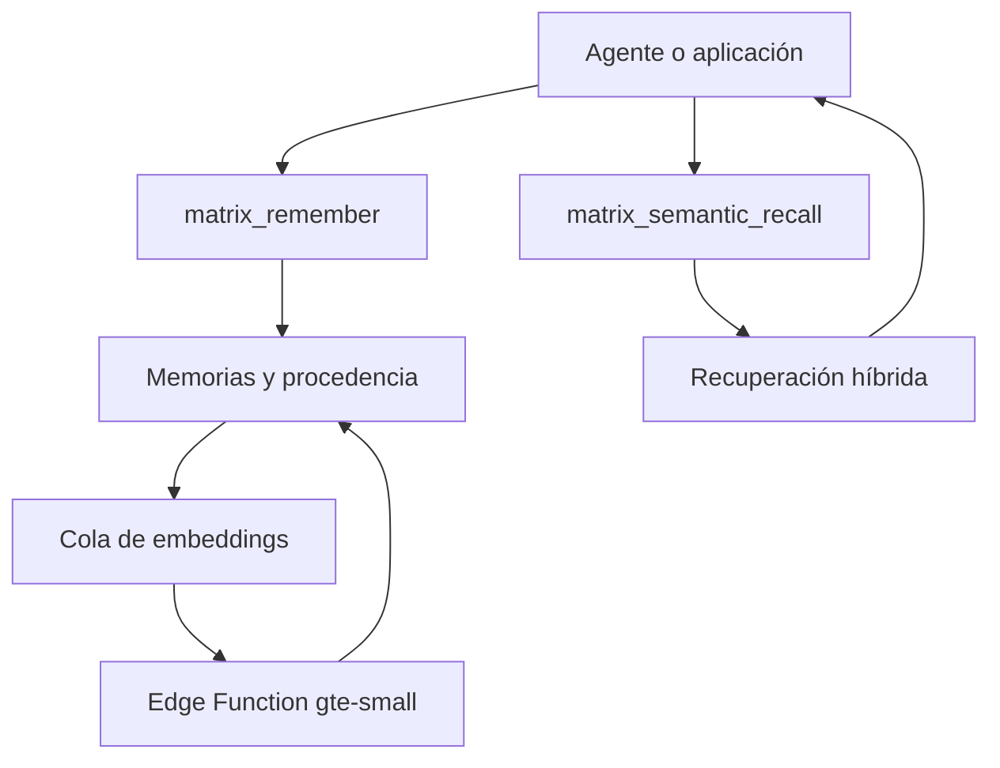

# Matrix Memory 1.2

Modelo educativo de memoria semántica de largo plazo para agentes de inteligencia artificial, construido con PostgreSQL, Supabase y `pgvector`.

Matrix no guarda una conversación completa como un bloque. Convierte la información en recuerdos atómicos con procedencia, tiempo, entidades, relaciones y un estado epistémico explícito. Después combina búsqueda de texto, similitud vectorial y contexto asociativo para recuperar lo relevante.

> Este repositorio contiene exclusivamente arquitectura, migraciones, funciones y datos sintéticos. No incluye recuerdos personales, identificadores reales, URLs de proyectos, claves ni credenciales.

## Pregunta de estudio

Si un agente puede conservar experiencias, decisiones, fuentes y relaciones a lo largo del tiempo, ¿estamos construyendo una base de conocimiento o una representación parcial de la identidad de una persona?

## Qué se aprende

- Modelar recuerdos como datos verificables y no como texto sin estructura.
- Diferenciar hechos, reportes, inferencias, decisiones e hipótesis.
- Evitar duplicados mediante una clave idempotente `event_key`.
- Preservar la procedencia de cada recuerdo.
- Proteger los datos de cada usuario con Row Level Security (RLS).
- Generar embeddings de forma asíncrona con colas y Edge Functions.
- Combinar texto completo y vectores en una recuperación híbrida.
- Expandir recuerdos relacionados mediante un grafo limitado.
- Registrar qué recuerdos fueron recuperados y cuántas veces.

## Arquitectura general



## Contrato 1.2

| Operación | RPC | Propósito |
| --- | --- | --- |
| Escribir | `matrix_remember(jsonb)` | Guardar una memoria con procedencia e idempotencia |
| Recuperar sin embedding automático | `matrix_recall(jsonb)` | Combinar texto, vector opcional y asociaciones |
| Recuperar semánticamente | `matrix_semantic_recall(jsonb)` | Encolar o reutilizar el embedding de una consulta |
| Consultar el contrato | `matrix_schema_info()` | Descubrir versión, tipos y funciones disponibles |

Los embeddings usan `Supabase/gte-small` con 384 dimensiones. La escritura y recuperación ordinarias respetan la identidad autenticada y las políticas RLS.

## Ruta rápida de estudio

1. Lee [Guía de estudio](docs/study-guide.md).
2. Revisa [Modelo de memoria](docs/memory-model.md).
3. Recorre la [Arquitectura](docs/architecture.md).
4. Instala la migración base `0001` y después la actualización `0002`.
5. Carga el `seed.sql` con un usuario de prueba.
6. Ejecuta [Laboratorio SQL](examples/learning-lab.sql).
7. Revisa [Despliegue de embeddings](docs/deployment.md) si quieres activar la parte semántica.

## Instalación resumida

Requisitos:

- Un proyecto de Supabase destinado a pruebas.
- Supabase CLI actualizado.
- Un usuario de prueba creado mediante Supabase Auth.

```bash
supabase link --project-ref TU_PROJECT_REF
supabase db push
supabase functions deploy memory-write
supabase functions deploy memory-recall
supabase functions deploy matrix-embedding-worker
supabase functions deploy matrix-query-embedding-worker
```

Antes de activar los workers, configura los secretos y el cron siguiendo [deployment.md](docs/deployment.md). Nunca uses un proyecto con datos reales para los ejercicios.

## Estructura

```text
docs/                         teoría, arquitectura y despliegue
examples/                     recuerdos y ejercicios sintéticos
skill/matrix-memory.example/  ejemplo de integración con un agente
supabase/functions/           API y workers de embeddings
supabase/migrations/          esquema 1.1 y actualización 1.2
supabase/snippets/            activación manual y consciente
tests/                        contrato y controles básicos
```

## Seguridad

- Todas las tablas expuestas tienen RLS.
- Los RPC públicos operan como `security invoker`.
- Las funciones privilegiadas viven en el esquema `private` y no son ejecutables por usuarios normales.
- Los workers sin verificación JWT exigen un secreto específico en `x-matrix-worker-secret`.
- Ninguna clave `service_role`, conexión de base de datos o secreto de Vault debe entrar en Git.

Consulta [security.md](docs/security.md) antes de adaptar el proyecto a información real.

## Estado

Versión educativa del contrato **Matrix 1.2**, actualizada a partir de una implementación funcional y sanitizada para fines de aprendizaje.

## Referencias

- [Supabase AI & Vectors](https://supabase.com/docs/guides/ai)
- [Automatic embeddings](https://supabase.com/docs/guides/ai/automatic-embeddings)
- [Row Level Security](https://supabase.com/docs/guides/database/postgres/row-level-security)
- [Edge Function configuration](https://supabase.com/docs/guides/functions/function-configuration)

## Licencia

MIT. Puedes estudiar, modificar y reutilizar el modelo citando el repositorio.
