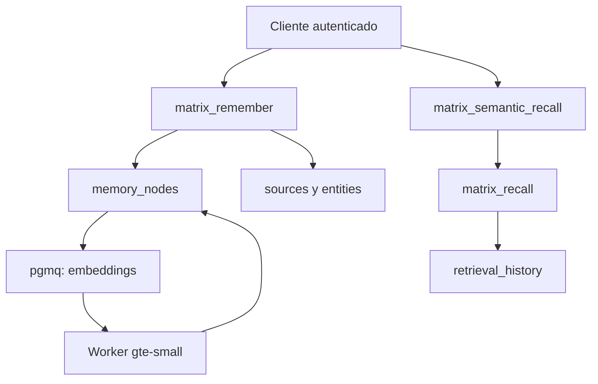

# Arquitectura

Matrix separa escritura, almacenamiento, enriquecimiento y recuperación. Esta división permite reemplazar una parte sin perder el contrato de las demás.

## Componentes persistentes

| Componente | Responsabilidad |
| --- | --- |
| `memory_nodes` | Recuerdos atómicos y señales de recuperación |
| `sources` | Procedencia y evidencia original |
| `entities` | Personas, proyectos, tecnologías y conceptos reutilizables |
| `memory_entities` | Participación de una entidad en un recuerdo |
| `memory_edges` | Relaciones causales, temporales y semánticas |
| `memory_versions` | Estado anterior de recuerdos modificados |
| `retrieval_history` | Consultas, resultados y metadatos de recuperación |
| `matrix_recall_requests` | Caché temporal del embedding de una consulta |

## Escritura canónica

`matrix_remember(jsonb)` es la única frontera estable de escritura. La función:

1. determina al propietario autenticado;
2. valida los campos mínimos;
3. adquiere un bloqueo transaccional por `event_key`;
4. devuelve el recuerdo existente en un reintento;
5. crea o reutiliza la procedencia;
6. asigna el periodo activo cuando aplica;
7. crea el nodo y reutiliza entidades;
8. conecta relaciones válidas del mismo propietario.

## Enriquecimiento asíncrono

Un trigger calcula un hash sólo con los campos usados por el embedding. Si cambian, limpia el vector y encola un trabajo. El worker confirma que el hash continúe vigente antes de escribir el resultado; así evita aplicar un vector obsoleto después de una edición.

Los cambios internos del embedding no modifican la fecha sustantiva del recuerdo ni crean versiones falsas.

## Recuperación

`matrix_semantic_recall(jsonb)` busca un embedding de consulta vigente. Si no existe, crea una solicitud, la encola y devuelve `pending`. Cuando el worker termina, la misma llamada entrega `ready` y ejecuta `matrix_recall(jsonb)`.

`matrix_recall` fusiona texto y vector, actualiza `recall_count`, registra `retrieval_history` y expande asociaciones desde los primeros recuerdos semilla.

## Aislamiento

Todas las filas pertenecen a un usuario. RLS compara `owner_id` con `auth.uid()`. Los triggers del grafo agregan una segunda validación para impedir relaciones entre propietarios diferentes.
