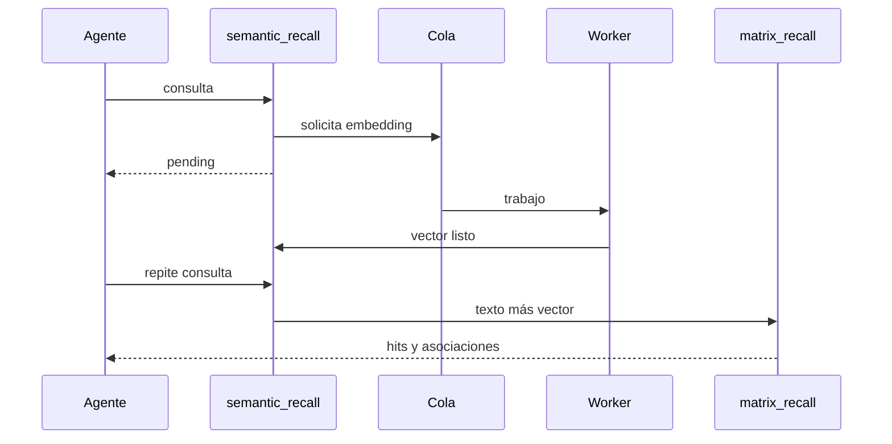

# Flujo de recuperación

## Recuperación semántica



1. El agente envía una consulta textual.
2. `matrix_semantic_recall` normaliza la consulta y calcula un hash.
3. Si el vector no existe o expiró, crea una solicitud y devuelve `pending`.
4. El worker genera un embedding `gte-small` de 384 dimensiones.
5. Una llamada posterior reutiliza el vector durante 24 horas.
6. `matrix_recall` ejecuta la recuperación híbrida.

## Ranking híbrido

El RPC canónico `matrix_recall` construye dos rankings independientes dentro de su consulta; `recall_memories` conserva la misma fórmula de ranking:

- texto completo en español;
- distancia coseno del embedding.

Los fusiona mediante **RRF ponderado**, con constante `k = 1`:

```text
score = 0.30 / (1 + posición_textual)
      + 0.45 / (1 + posición_semántica)
      + 0.10 * importancia / 100
      + 0.05 * confianza / 100
      + 0.05 * intensidad_emocional / 100
      + bono_título
```

Las posiciones comienzan en uno. Una lista que no contiene el recuerdo aporta cero. `bono_título` vale `0.05` cuando el título contiene la consulta completa, ignorando mayúsculas, y cero en otro caso. Estos coeficientes no son porcentajes de precisión. La coincidencia de título es un bono, no una tercera lista. El objetivo es ordenar candidatos, no certificar verdad o vigencia.

Esta fusión precede a MCP 1.8.0. La [tolerancia ortográfica](spanish-spelling.md) devuelve `spelling_candidates` separados: no altera la consulta, los `hits` habituales ni la fórmula RRF. El [contexto reciente](current-topic-context.md) también aporta evidencia separada que debe revisarse con sus fuentes.

## HNSW y uso efectivo del índice

Las migraciones crean `memory_nodes_embedding_hnsw_idx` con `USING hnsw (embedding vector_cosine_ops)`. HNSW puede acelerar la selección de vecinos vectoriales aproximados; RRF fusiona rankings. Son funciones complementarias.

**Crear el índice no demuestra que una consulta lo utilice.** La consulta actual reutiliza el CTE `filtered` para texto, vectores y unión final. En la inspección del SELECT de ranking del 13 de noviembre de 2026, el plan materializó ese conjunto y ordenó sus vectores mediante `CTE Scan` y `Sort`, sin acceso HNSW. El índice estaba válido y listo, con `idx_scan = 0` en las estadísticas observadas. El contador no es prueba absoluta de toda la historia del índice.

En esa instalación, la muestra tenía 758 recuerdos con vectores y un índice de 1,528 KiB en disco. El SELECT de ranking tardó aproximadamente 16 ms, con unos 11 ms de planificación. Fue una consulta con embedding ya disponible y no mide latencia MCP completa, RAM ni rendimiento general. Los tamaños y planes dependen de cada instalación.

No se fuerza HNSW ni se cambia el ranking en 1.8.0. Si el volumen o la latencia justifican optimizarlo, comparar el plan actual con una consulta candidata que pueda usar el índice, verificando recuperación frente a búsqueda exacta, filtros por propietario/RLS, límites, tiempos y recursos. HNSW intercambia recuperación por velocidad; no mejora por sí mismo el significado del embedding, la ortografía ni el soporte de idiomas. Una tabla pequeña puede favorecer un recorrido exacto.

Referencias: [HNSW en Supabase](https://supabase.com/docs/guides/ai/vector-indexes/hnsw-indexes), [pgvector](https://github.com/pgvector/pgvector), [búsqueda híbrida y RRF](https://supabase.com/docs/guides/ai/hybrid-search).

## Asociaciones

Los primeros cinco resultados pueden convertirse en semillas. `memory_context` recorre relaciones hasta dos saltos, evita ciclos y reduce la activación en cada salto.

## Trazabilidad

Cada ejecución canónica crea una fila en `retrieval_history`. Sólo los resultados directos aumentan `recall_count`; los vecinos asociados no se cuentan como recuperaciones directas. En MCP 1.8.0, un suplemento ortográfico con candidatos crea además su propio registro de historial e incrementa los contadores de esos candidatos, conservando el historial de la búsqueda habitual. No cambia su contenido.

## Fallback textual

Si no se desea generar un embedding, se puede llamar `matrix_recall(jsonb)` sin `query_embedding`. El resultado continúa siendo trazable y utiliza texto completo, señales de memoria y asociaciones.
