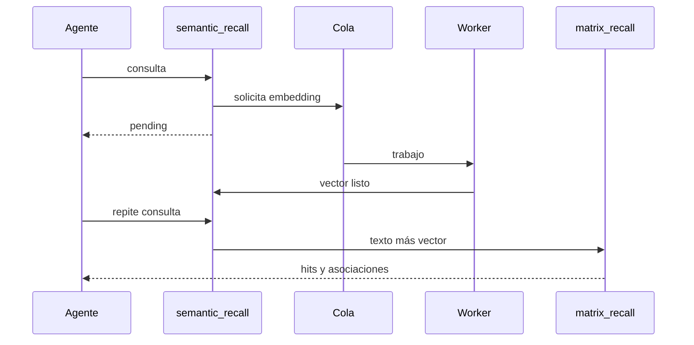

# Flujo de recuperación

## Recuperación semántica

1. El agente envía una consulta textual.
2. `matrix_semantic_recall` normaliza la consulta y calcula un hash.
3. Si el vector no existe o expiró, crea una solicitud y devuelve `pending`.
4. El worker genera un embedding `gte-small` de 384 dimensiones.
5. Una llamada posterior reutiliza el vector durante 24 horas.
6. `matrix_recall` ejecuta la recuperación híbrida.

## Ranking híbrido

`recall_memories` crea rankings independientes:

- texto completo en español;
- distancia coseno del embedding;
- coincidencia directa del título.

Después incorpora importancia, confianza y saliencia. El objetivo no es declarar una verdad absoluta, sino ordenar candidatos útiles.

## Asociaciones

Los primeros cinco resultados pueden convertirse en semillas. `memory_context` recorre relaciones hasta dos saltos, evita ciclos y reduce la activación en cada salto.

## Trazabilidad

Cada ejecución canónica crea una fila en `retrieval_history`. Sólo los resultados directos aumentan `recall_count`; los vecinos asociados no se cuentan como recuperaciones directas.

## Fallback textual

Si no se desea generar un embedding, se puede llamar `matrix_recall(jsonb)` sin `query_embedding`. El resultado continúa siendo trazable y utiliza texto completo, señales de memoria y asociaciones.
